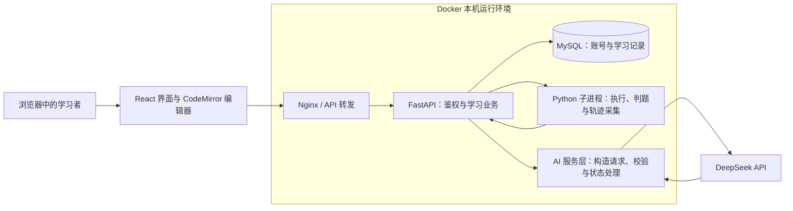
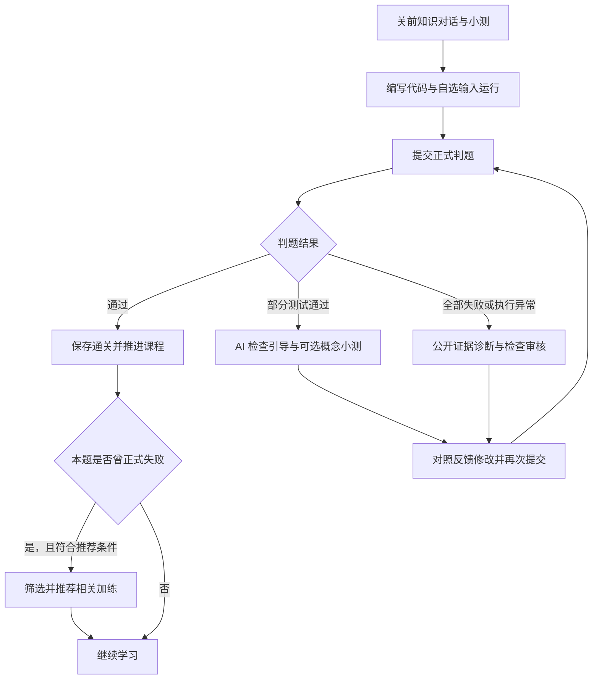

# Ottly误区感知编程陪学——技术方案初稿

> 写作基线：`921fd5d`；整理日期：2026-10-26。
> 本文依据官网参考大纲和当前实现撰写，尚未套入官网下载模板。所有【待补】内容需由实际记录补齐，本文不能作为最终验收报告直接提交。
> 作品名称暂定，提交时确认不超过官方字数要求。团队编号、成员分工和发布版本待团队确认；评审材料不加入学校名称、学校 Logo 或指导教师信息。

## 一、产品概述与定位

### 1.1 背景与目标

Python 初学者在练习中需要理解三个相互关联的问题：代码是否符合题目要求、运行过程中发生了什么，以及下一次应该重点练习什么。单独的判题结果能指出测试是否通过，但通常不能完整解释变量如何变化；自由问答则需要学习者主动整理代码、输入与错误信息。

Ottly 将课程引导、代码执行、判题、AI 反馈、错题复习和针对性加练放在同一学习流程中。系统先取得实际执行结果，再组织模型可以使用的公开证据，帮助学习者对照代码检查自己的理解。角色化界面和逐关课程用于降低首次接触编程时的操作负担。

本项目的目标是提供可运行、可检查的 Python 入门陪学软件。当前材料主要说明功能实现与反馈机制，学习效果仍需要通过真实试用和进一步研究验证。

### 1.2 产品定位与使用场景

产品面向学习输入输出、变量、条件、循环、字符串、列表和基础函数的零基础学习者。核心场景是独立练习时遇到错误，希望获得与本次代码相关的解释，并在修改后继续巩固。

当前版本包含正式主线 12 关和固定加练题 66 道。学习者在关前阅读知识对话、完成概念小测，随后编写和运行代码，通过正式判题推进关卡。错题可以再次进入复习；主线题从失败修改为通过后，可以获得一道相关加练推荐。全部主线完成后，开放无尽挑战中的抽题与 AI 出题。

### 1.3 作品简介草稿

Ottly 是面向 Python 零基础学习者的误区感知编程陪学系统。系统以 12 关课程串联知识引导、编程练习、自动判题、AI 反馈、错题复习与针对性加练。判题依据实际执行结果完成，AI 根据公开执行证据提供解释；代码回放展示变量和输出变化，并支持按需步骤讲解。系统结合疑似误区、知识点与难度安排加练，通关后支持生成挑战题。项目采用 Docker 本机部署，模型通过 DeepSeek API 调用，便于演示与复现。

【待补】有真实测试或试用结果后，选择一项有证据的结果加入简介；上传前再次检查字数。

## 二、技术架构与创新

### 2.1 总体架构

前端使用 React 构建课程、编辑器、反馈和回放界面，代码编辑使用 CodeMirror。后端使用 FastAPI 提供鉴权、题目、运行、判题和 AI 接口，MySQL 保存账号及学习记录。执行服务在短生命周期 Python 子进程中运行代码并收集结果。AI 请求由后端统一调用 DeepSeek，密钥不进入前端。



图中子进程与后端处于同一后端容器，不能据此声称每次运行都有独立容器隔离。回放会话与当前聊天会话指针使用后端内存，其恢复范围与数据库记录不同。

### 2.2 技术选型

| 组件 | 作用与选择理由 |
| --- | --- |
| React、CodeMirror | 复用主线、加练与复习的编辑体验，支持语法高亮和草稿恢复 |
| FastAPI、Pydantic | 定义请求及模型输出结构，集中处理鉴权、参数和反馈状态 |
| Python 执行子进程 | 获取真实输出、异常与执行轨迹，设置执行时间和资源范围 |
| MySQL | 保存提交、学习进度、错题相关记录与账号生成题 |
| DeepSeek API | 提供问答、诊断、引导、候选选择、出题和步骤讲解能力；当前代码请求名为 `deepseek-flash` |
| Docker Compose | 编排数据库、后端和前端，统一本机演示环境 |

### 2.3 核心设计贡献

**基于实际执行证据的反馈。** 程序先形成执行和判题结果，再从允许公开的结果中选择证据，整理输出差异与逐行匹配信息。模型输出经过结构、证据引用、知识点和内容检查，并进行另一次模型审核。该流程旨在减少无依据解释，实际改善幅度需要通过对照测试确认。

**按失败情况选择反馈方式。** 全部失败或运行异常可进入诊断流程；部分测试通过时提供检查方向和可选概念小测，不强行输出误区标签。正式判题通过时不再产生错误诊断。AI 输出不能改写判题、通关或解锁结果。

**把修正后的学习安排接入同一流程。** 系统识别主线题从失败到通过的记录，在合适候选中先按疑似误区、知识点和难度排序。唯一最佳候选直接推荐，多道并列最佳候选才由模型辅助选择；模型异常时可以使用规则结果。当前目标难度固定为 1，应将其表述为有边界的适应性练习安排。

**真实轨迹回放与按需讲解。** 程序采集当前代码在指定输入下的实际轨迹，界面按设计好的动作规则展示执行变化。模型在学习者点击时解释指定步骤，界面不依赖模型生成动画。该能力目前仅开放给正式 12 关。

【待补】选择具名同类产品进行有日期和来源的功能比较。未核对前不写“行业首创”“全面领先”或未经测试的性能优势。

## 三、功能设计与实现

### 3.1 完整学习流程



正式提交记录支持错题与复习。自选输入运行、执行回放与正式判题的职责不同：自选输入成功不能证明所有正式测试通过，回放本身不写入通关成绩。

### 3.2 AI 入口的职责与数据

| 入口 | 输入与输出的主要职责 |
| --- | --- |
| 陪学与关前问答 | 根据当前问题、相应会话或关卡讲解回答；各入口的历史保存规则不同 |
| 错因诊断 | 使用当前代码和真实公开失败证据，输出疑似原因、证据和知识点；本次诊断不混入历史提交 |
| 部分通过引导 | 基于公开题意和结果提出下一步检查方向，不生成误区诊断 |
| 加练推荐 | 使用失败记录与受控候选题信息，在规则并列候选中辅助选择 |
| 无尽挑战出题 | 利用近期学习线索生成候选题、参考解和测试，再执行与审核；职责上需要处理候选题参考解及测试 |
| 回放步骤解释 | 使用题目、代码、输入和相邻执行快照，解释学习者选中的步骤 |

诊断、引导和推荐不向模型发送隐藏测试或参考解。出题与出题审核按其生成、验证职责处理候选参考解和测试，因此不能笼统写成“所有 AI 入口都不接触测试答案”。

### 3.3 执行回放的时间语义

高亮代码行表示即将执行的位置，动作区展示此前刚完成的动作，变量和累积输出对应当前快照。程序结束和异常时使用相应事件说明。输入、赋值、整数加法和字符串拼接等操作有专门展示规则，复杂表达式可以退回真实状态变化视图。

回放使用当前代码或本人已有提交版本，支持调整输入后重新运行。步骤解释按点击调用，结果按步骤缓存，切换步骤时不会把迟到回答放到另一条步骤下面。回放会话有时效与容量限制，服务重启或会话过期后需要重新生成。

### 3.4 代表案例：累加与覆盖赋值

建议以第 8 关的下列代码作为演示脚本，输入为 `3`：

```python
n = int(input())
total = 0
for i in range(1, n + 1):
    total = i
print(total)
```

这段程序逐轮把 `total` 替换成 `i`，最终输出 `3`；将循环体改为 `total += i` 后，同一输入的累积过程为 `0→1→3→6`。这两种操作可在回放中对照观察。

正式判题仍按实际测试形成结果：若部分测试通过，展示对应引导；只有进入诊断流程并取得可信标签时，才能把后续推荐描述为利用了该疑似误区。不要为演示预设模型一定返回某标签。

【待补】同一发布版本下的代码、公开输入输出、真实模型回答、回放截图、修改后的判题与实际加练推荐记录。当前段落是可复现的案例设计，尚不构成真实模型验收结论。

### 3.5 辅助功能与使用边界

账号鉴权与归属检查用于隔离提交、学习记录和个人生成题。浏览器草稿按账号 ID 与题目版本区分，方便返回页面后继续编辑；草稿不具备跨浏览器、跨设备同步能力。错题与加练沿用正式编辑和判题流程，便于学习者使用一致的操作方式。

全部主线通过后，无尽挑战允许从已有题库抽题，或请求模型生成新题。生成候选经过结构检查、参考解执行、模型审核及补充边界测试交叉执行，通过后按账号保存。同一模型参与生成与审核，仍可能存在共同遗漏，不能把程序检查通过表述为题意绝对正确。

## 四、开发测试与部署

### 4.1 开发过程与分工

建议按“课程与题库—运行判题—AI 反馈—错题与推荐—回放与交付”说明开发过程，每一阶段列出实际负责人、提交范围和验收结果。

【待补】真实成员分工、主要迭代日期和对应提交。不要根据 Git 作者直接推断成员完整工作量；删除与当前提交无关的旧路线描述。

### 4.2 当前证据与待完成测试

| 项目 | 目前可以引用的记录 | 结论边界 |
| --- | --- | --- |
| 前端回归 | `921fd5d` 对应界面修改已完成全量 110 项前端测试 | 自动测试通过不等于 AI 内容正确 |
| 构建与服务 | 本机 Docker 构建、启动及健康接口检查已完成 | 尚不能代表另一台干净电脑独立复现 |
| 后端回放相关测试 | 拉取 `4e13999` 时执行 39 项定向测试通过 | 是此前版本的专项结果，不能标成最终版本的后端全量报告 |
| 界面走查 | 第二关、累加/覆盖、列表等独立样例使用正式组件和真实 Python 快照检查 | 独立样例不代替正式账号完整流程 |
| 真实模型 | 仓库内有阶段验收描述 | 需收集原始响应与人工评分，不能汇总成当前版本已全面通过 |

以上是写作依据盘点，正式测试报告还需整理命令、环境、日期、日志路径、版本和缺陷处理记录。

最终报告建议分别验证软件行为、AI 语义质量和交付复现：软件验证课程解锁、判题、账号隔离、草稿和失败恢复；AI 验证证据真实性、解释是否正确、是否误指正确代码及是否泄露答案；交付验证由另一人在干净环境中完成启动、登录、运行、模型调用和重启。

AI 测试须记录全部有效与失败请求。返回率、语义合格率、端到端有效反馈率分开计算，耗时报告中位数和 P95，并保留样本量、重复次数及 token 用量。Mock 结果和真实 API 结果分开呈现。详细样本设计见[收尾计划](../competition-finalization-plan.md)。

【待补】最终发布版本、设备和网络条件、后端全量结果、真实 AI 评测、人工复核及独立部署记录。当前没有可用于声称学习效率提升的数据。

### 4.3 部署与评审复现

当前交付方式为 Windows + Docker Desktop 本机运行包。启动前开启 Docker Desktop，使用项目 `start-demo.bat` 构建并启动服务，浏览器访问 `http://127.0.0.1:3000`。模型功能需要后端配置有效 DeepSeek 密钥并可访问服务；本机部署不等于 AI 离线推理。

运行包应附部署说明、配置示例、依赖锁定信息和版本标识。若提供预构建镜像，还需实际验证导入与启动流程。真实 `.env`、账号资料、数据库卷及研究缓存不进入交付包。

Docker 容器启用了只读文件系统、非 root 用户和资源约束，但用户代码执行子进程不具备面向恶意代码的独立操作系统隔离。当前定位为受控本机演示，不应直接作为公网任意代码执行服务发布。

详细命令以[项目 README](../../README.md)为准；正式交付前另外整理面向评审的简短启动和体验步骤。

## 五、应用价值与展望

### 5.1 已实现的场景价值

Ottly 将题目、代码、公开执行证据、反馈与后续练习关联到同一次学习活动中，支持学习者返回具体代码检查。回放提供可重复观察的过程，改对后的加练提供进一步练习入口。这些功能构成当前可展示的应用场景。

【待补】匿名试用任务、参与人数、参与者实际经验、任务完成情况、操作障碍及原始反馈。若参与者是团队成员或成年人，应按真实身份报告；短时试用不推出儿童长期学习效果。

### 5.2 局限与后续方向

当前课程与疑似误区词表范围有限，推荐难度策略固定；回放仅支持正式关卡和限定语法；模型仍可能误判，同模型审核不能保证发现全部问题。产品也尚未验证大规模并发、长期学习成效与公开部署安全性。

后续可优先扩展加练题回放，并按语法能力统一支持范围；根据人工复核结果改进证据组织与模型提示；在可控试用中评估不同反馈方式的作用，再决定是否引入更细的学习状态和难度策略。每项扩展应给出验收条件后实施。

## 六、附录与来源

### 6.1 核心实现索引

| 说明对象 | 源码与资料 |
| --- | --- |
| 公开证据、诊断和部分通过引导 | [error_analysis.py](../../backend/app/services/error_analysis.py) |
| 规则排序与 AI 并列候选选择 | [practice_recommendation.py](../../backend/app/services/practice_recommendation.py) |
| 正式关卡回放接口与权限 | [execution_trace.py](../../backend/app/api/execution_trace.py) |
| 动作规则与实际状态对应 | [trace_actions.py](../../backend/app/services/sandbox/trace_actions.py) |
| 按需模型步骤讲解 | [trace_explanation.py](../../backend/app/services/trace_explanation.py) |
| 无尽挑战生成与校验 | [endless.py](../../backend/app/services/endless.py) |
| 课程与加练设计来源 | [教学参考](../03-12关题库选型与教学详解.md)、[加练接入说明](../2026-10-18-12关针对性加练候选题.md) |

### 6.2 官方依据

- [AI+软件创新赛题与参考大纲](https://www.aicomp.cn/tracks/tracks-2/3792.html)。
- [2026 算法创新赛规则](https://www.aicomp.cn/wp-content/uploads/2026/05/2026AIC%E7%AE%97%E6%B3%95%E5%88%9B%E6%96%B0%E8%B5%9B%E8%B5%9B%E9%A2%98%E8%A7%84%E5%88%99%E6%B1%87%E6%80%BB260506-1.pdf)：材料格式、大小、模板入口及匿名要求。

【待补】第三方依赖和许可证、插画与图标来源、实际阅读引用的技术文档或论文、脱敏测试数据索引。仅在具备相应材料时加入软著、论文、用户应用等佐证。
